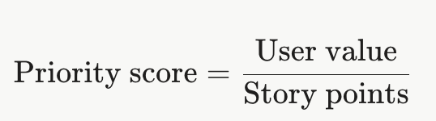

# Overview

In this project your Scrum team will build **CampusEats**, a web app for rescuing surplus food on campus, over three one-week sprints. Before Sprint 1 starts, your team scores and prioritizes the Product Backlog and plans which user stories go into which sprint. During the sprints you run Scrum events, track work on a Kanban board, use Git and GitHub with one tagged release per sprint, and deploy the app with Docker Compose and PostgreSQL.

# Teams Setup

Teams must have 3 to 5 members, no exceptions. Your team does not need to be the same as in previous project.

Each team designates one member as the **Scrum Master** before Sprint 1 begins and records that name in the README. The Scrum Master also writes code, but is additionally responsible for facilitating sprint planning, daily scrums, reviews and retrospectives, making sure meeting notes are recorded in the scrum folder on time. 

The Product Owner role is played by the instructor. The instructor has written the backlog and set the user value of each story; your team decides effort, priority within the rules below, and how the work is split.

```
Scrum Master: <student's name>
```

# Project Vision

**CampusEats** connects campus food vendors that have leftover food with students who want it, so less food is thrown away and fewer students go hungry.

Today, dining halls and campus cafés throw away trays of good food at closing time, while many students skip meals to save money. Vendors have no simple way to announce leftovers, and students hear about them too late or not at all. The campus sustainability office wants a web app where vendors post surplus food with a pickup window, students reserve portions, and vendors confirm pickups so the office can measure how much food was rescued.

# Product Backlog

The backlog has 10 user stories: US1 to US7 are required and US8 to US10 are optional. User value is set by the Product Owner: 3 = high, 2 = medium, 1 = low. "Depends on" means a story cannot start until the listed stories are finished (merged into dev and passing their acceptance criteria).

| ID | User story | User value | Depends on | Type |
| --- | --- | --- | --- | --- |
| US1 | As a new user, I want to register and log in as either a student or a vendor so that I can use the features for my role. | 3 | — | Required |
| US2 | As a vendor, I want to post a surplus food listing with portions and a pickup window so that students know what food is available and when. | 3 | US1 | Required |
| US3 | As a student, I want to browse the food listings that are currently available so that I can find food before it is thrown away. | 3 | US2 | Required |
| US4 | As a student, I want to reserve portions from a listing so that the food is held for me until I pick it up. | 3 | US1, US3 | Required |
| US5 | As a vendor, I want to edit or cancel my listings and see who reserved them so that the information students see stays accurate. | 2 | US2, US4 | Required |
| US6 | As a student, I want to see and cancel my reservations so that portions I no longer need are released to other students. | 2 | US4 | Required |
| US7 | As a vendor, I want to confirm a pickup by entering the student's pickup code so that food goes only to the student who reserved it. | 3 | US4 | Required |
| US8 | As a student, I want to filter listings by dietary tag and campus location so that I only see food I can eat and reach. | 2 | US3 | Optional |
| US9 | As a vendor, I want an impact dashboard showing portions rescued and no-shows so that I can report results to the sustainability office. | 1 | US7 | Optional |
| US10 | As a student, I want to rate a pickup after collecting my food so that vendors get feedback on quality and service. | 1 | US7 | Optional |

# Acceptance Criteria

A story is done only when every one of its acceptance criteria passes in the Docker Compose deployment. Use these criteria to write your Selenium test and your manual test cases.

## US1: Register and log in (Required)

1. Given I am on the registration page, when I enter a name, a unique email, a password of at least 8 characters, select "Student" or "Vendor", and click "Register", then my account is stored in PostgreSQL and I am redirected to the login page.
2. Given an account with that email already exists, when I submit the form, then no account is created and I see an error saying the email is already registered.
3. Given any required field is empty, when I submit the form, then no account is created and the empty field is identified.
4. Passwords are stored hashed, never in plain text.
5. Given I have an account, when I log in with the correct email and password, then I land on the home page for my role; with a wrong password, I see an error and stay logged out.

## US2: Post a surplus food listing (Required)

1. Given I am logged in as a vendor, when I enter a title, description, number of portions (1 to 100), pickup location, zero or more dietary tags (vegetarian, vegan, gluten-free, halal, contains nuts), and a pickup window start and end, and click "Post", then the listing is stored and linked to my vendor account.
2. Given the pickup window end is before its start, or the end is in the past, when I click "Post", then the listing is not saved and I see an error.
3. Given I am logged in as a student, when I try to open the new-listing page, then access is denied.

## US3: Browse available listings (Required)

1. Given I am logged in as a student, when I open the listings page, then I see every listing whose pickup window has not ended, that has at least one portion left, and that has not been cancelled.
2. Each listing shows its title, vendor name, pickup location, dietary tags, portions remaining, and pickup window.
3. Listings are sorted by pickup window end, soonest first.
4. Given no listings are available, then I see a message saying so instead of an empty page.

## US4: Reserve portions (Required)

1. Given a listing has portions remaining, when I choose 1 or 2 portions and click "Reserve", then a reservation is stored, the listing's remaining portions decrease by that amount, and I see a unique 6-character pickup code.
2. Given I request more portions than remain, then no reservation is created and I see an error.
3. Given I already hold an active reservation for that listing, when I try to reserve again, then I am told I already have a reservation.
4. Given two students reserve the last portion at the same moment, then only one reservation succeeds (remaining portions never go below zero).

## US5: Manage listings (Required)

1. Given I am logged in as a vendor, when I open "My Listings", then I see all my listings with their status (active, ended, cancelled) and portions reserved and remaining.
2. Given a listing has no reservations, when I edit its fields and save, then the changes are stored and validated with the same rules as US2.
3. Given a listing has reservations, when I edit it, then I cannot set the number of portions below the number already reserved.
4. When I cancel a listing, then it no longer appears to students and all its active reservations are marked cancelled.
5. When I open a listing, then I see the name and portions of every student who reserved it. Vendors cannot see or change other vendors' listings.

## US6: View and cancel my reservations (Required)

1. Given I am logged in as a student, when I open "My Reservations", then I see each reservation with listing title, vendor, location, pickup window, portions, pickup code, and status (active, picked up, cancelled, no-show).
2. Given a reservation is active and its pickup window has not ended, when I click "Cancel", then its status becomes cancelled and its portions are returned to the listing.
3. Given a reservation is not active, then no "Cancel" option is shown.

## US7: Confirm pickup (Required)

1. Given I am logged in as a vendor, when I enter a pickup code for an active reservation on one of my listings during its pickup window, then the reservation status becomes "picked up" and I see the student name and portions to hand out.
2. Given the code does not exist, belongs to another vendor's listing, or was already used or cancelled, then the pickup is rejected with a clear message.
3. Given a pickup window has ended, then every reservation on that listing that is still active is shown with status "no-show".

## US8: Filter listings (Optional)

1. Given I am on the listings page, when I select one or more dietary tags, then only listings that have all selected tags are shown.
2. When I select a campus location, then only listings at that location are shown; filters can be combined with dietary tags.
3. When I click "Clear filters", then all available listings are shown again.

## US9: Impact dashboard (Optional)

1. Given I am logged in as a vendor, when I open the dashboard and choose a date range, then I see the number of listings posted, portions posted, portions picked up, and no-show count for my listings in that range.
2. The no-show rate is shown as a percentage of reserved portions.
3. Given there is no data in the range, then all values show 0 and no error occurs.

## US10: Rate a pickup (Optional)

1. Given a reservation of mine has status "picked up", when I give it 1 to 5 stars and an optional comment of up to 300 characters and click "Submit", then the rating is stored and linked to that reservation.
2. I can rate each picked-up reservation only once; reservations in any other status cannot be rated.
3. Vendors see the average rating and the comments for each of their listings.

# Scoring and Prioritizing the Backlog

Before Sprint 1 starts, your team estimates every story and ranks the backlog using the same method as Activity 17. Record the result in the table below. 

| ID | Short name | User value | Story points | Priority score | Rank |
| --- | --- | --- | --- | --- | --- |
| US1 | Register and log in | 3 |  |  |  |
| US2 | Post a listing | 3 |  |  |  |
| US3 | Browse listings | 3 |  |  |  |
| US4 | Reserve portions | 3 |  |  |  |
| US5 | Manage listings | 2 |  |  |  |
| US6 | My reservations | 2 |  |  |  |
| US7 | Confirm pickup | 3 |  |  |  |
| US8 | Filter listings | 2 |  |  |  |
| US9 | Impact dashboard | 1 |  |  |  |
| US10 | Rate a pickup | 1 |  |  |  |
| **Total** |  |  |  |  |  |

Priority Score Formula: 



# Sprint Planning

The project runs as a planning phase (Sprint 0) followed by three one-week sprints, and every sprint ends with a tagged release (v1, v2, and v3).

Before writing any code, split the backlog across the three sprints and record it below. Follow these rules:

* Capacity: set your team's capacity in story points per sprint and justify it in one or two sentences (team size, hours available, course load). No sprint may exceed it.
* Dependencies: a story can be in the same sprint as a story it depends on only if the plan shows the dependency finishing first; otherwise it goes in a later sprint.
* Required first: all seven required stories (US1 to US7) must be planned for Sprints 1 to 3. Optional stories (US8 to US10) are planned only in space left over.
* Priority: within those limits, higher-ranked stories go earlier.
* Planned burndown: list the story points remaining at the start and after each planned sprint.

```
Team capacity (story points per sprint): <your team's capacity>

Justification (one or two sentences: team size, hours available, course load): <justification>
```

| Sprint | User stories (in order) | Story points planned | Points remaining after sprint | Dependencies checked (Y/N) |
| --- | --- | --- | --- | --- |
| Sprint 1 |  |  |  |  |
| Sprint 2 |  |  |  |  |
| Sprint 3 |  |  |  |  |
| **Total** |  |  | — | — |

# Sprint Boards

Track all tasks on a GitHub Projects board, Microsoft Teams pages, or any other tool of your preference. 

* Use at least these columns: To Do, In Progress, In Review, Done.
* Create one GitHub issue per task, labeled with its user story (for example US4), assigned to its owner, and linked from the pull request that completes it.
* Move cards as work progresses, not all at once at the end of the sprint.
* At the end of each sprint, add a screenshot of the board to the **scrum** folder (for example scrum/sprint_#/board.png). 

# Design

Deliver a UML class diagram and at least one sequence diagram, written in PlantUML and committed to the **uml** folder by the end of Sprint 1. Update them in later sprints if the design changes.

* Domain model in **uml/class.wsd**: the main classes (at least User, Vendor or role, Listing, Reservation, and DietaryTag), their key attributes, and their associations with multiplicities. Your database tables should be traceable to this model.
* Sequence diagram in **uml/sequence-US#.wsd** (for example uml/sequence-US4.wsd): the full flow of one user story from the browser through the Flask route, any service or model classes, and PostgreSQL, including at least one alternative path (for example, not enough portions left). US4 or US7 are good choices because they involve validation and state changes.

# Implementation and Deployment

Implement all seven required user stories in Python with Flask, store all data in PostgreSQL, and deploy the app with Docker Compose (as done in Activity 18).

* Framework: Python 3 and Flask. You may use extensions such as Flask-SQLAlchemy, Flask-Login, and Flask-WTF.
* Database: PostgreSQL only; SQLite and in-memory storage are not accepted. Create the schema automatically on startup or through migrations (for example Flask-Migrate), so no manual SQL is needed.
* Configuration: read the database URL and secret key from environment variables. 

Include a **Dockerfile** for the web app and a **docker-compose.yml** with at least two services:

* db: the official postgres image, with a named volume so data survives restarts.
* web: your Flask app, built from the **Dockerfile**, waiting for db to be ready before starting.

The instructor must be able to run the app with a single command from the repository root:

```
docker compose up --build
```

and then open it at http://localhost:5000. The README must list this command and include seed accounts (at least one vendor and one student with a few sample listings) created automatically on first start, so the app can be graded without manual data entry.

# Scrum Evidence

Your team is graded on how closely it followed Scrum, so every Scrum event must leave a dated record in the **scrum** folder.

* Daily scrums may be held in person or asynchronously (for example in a team Discord or Teams channel), but each one must be recorded with its date in the sprint file. The Scrum Master records the notes.
* From Sprint 2 on, the retrospective must say whether the previous sprint's actions were carried out.
* At the end of the project, complete a burndown chart using the provided template, with three lines: ideal, planned (from your release plan), and actual story points remaining after each sprint. Add one or two sentences explaining any gap between planned and actual.

# Version Control and Releases

Use Git and a single GitHub repository for the team, with a **dev** branch for integration and three tagged releases (v1, v2, v3) on **main**, one per sprint.

* Branches: create **dev** from main at the start of the project. Do each task or story on a topic branch named after it (for example US4-reserve-portions), branched from **dev**.
* Pull requests: merge topic branches into **dev** through pull requests, each reviewed and approved by a team member other than its author. The history of **dev** must show multiple merges from every team member.
* Releases: at the end of each sprint, merge **dev** into **main** and tag the merge commit. 

# Testing

Write one automated black box test with Selenium for one user story of your choice, and manually test every other story you implement.

* Automated test: place it in tests/ and make it cover every acceptance criterion of the chosen story, including at least one failure case (for example a duplicate email for US1, or reserving more portions than remain for US4). The test drives the app through the browser against the running Docker Compose deployment; it must not call your Python functions directly. Explain in the README how to run it.
* Manual tests: for every other implemented story, test each acceptance criterion by hand and record the results in tests/manual-tests.md using this table. Re-test stories from earlier sprints before each release.

| User story | Acceptance criterion | Tester | Date | Result | Notes |
| --- | --- | --- | --- | --- | --- |
| US1 | 2: duplicate email rejected | Name | 99/99/26 | passed |  |
| ... | ... | ... | ... | ... | ... |

# Repository Structure

```
|__src/
|____...
|__uml/
|____class.wsd
|____sequence-US#.wsd
|__scrum/
|____sprint_#/
|______board.png
|______planning.md
|______daily_scrums.md 
|______review.md
|______retrospective.md
|__tests/
|____...
Dockerfile
docker-compose.yml
.gitignore
.venv
.env
.env.example
requirements.txt
burndown.[xlsx|png]
README.md
```

**.env** and **.venv** must be listed in **.gitignore** and never committed. Create a **.env.example** with placeholder values. 

# Self and team evaluation

Each student must complete a self-evaluation and evaluate their teammates using [this](https://forms.cloud.microsoft/r/ucKeDFVzmf) form. The team's grade is held until every member has submitted.

# Rubric

* +49 for required user stories US1 to US7 (7 points each, all acceptance criteria passing)
* +5 for design:
    * +3 class diagram
    * +2 sequence diagram
* +5 for PostgreSQL and Docker Compose deployment
* +5 for testing:
    * +3 Selenium black box test
    * +2 manual test evidence
* +21 for Scrum project management:
    * +3 backlog scoring and release plan (Sprint 0)
    * +3 sprint planning with task breakdown and assignments (screenshot evidence)
    * +3 Kanban board use (screenshot evidence)
    * +3 daily scrums
    * +3 sprint reviews
    * +3 sprint retrospectives
    * +3 burndown chart (screenshot evidence)
* +5 for version control:
    * +2 branches and reviewed pull requests
    * +3 three tagged releases
* +10 for self and team evaluation

**Total: 100 points**

**Bonus**

* +3 for each optional story (US8 to US10) that passes all its acceptance criteria, up to +9

**Deductions**

* −3 if a team has no designated Scrum Master recorded in the README